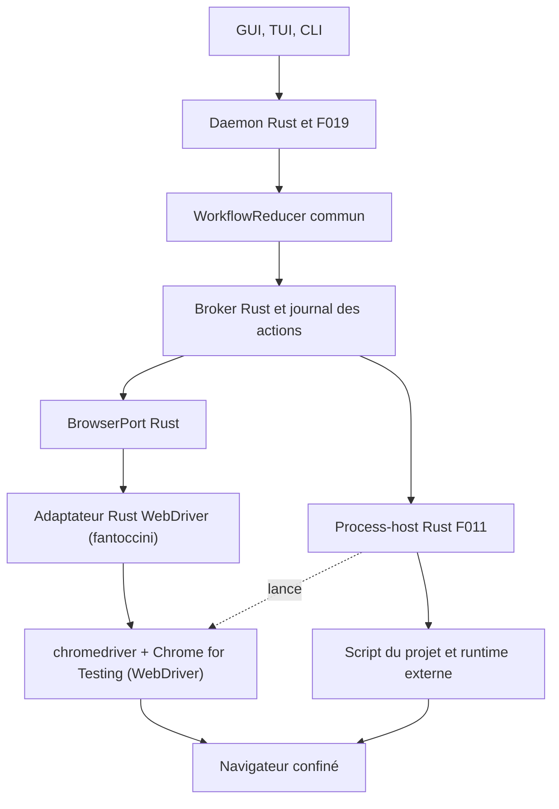

# Exécution navigateur — architecture R3

**Statut : proposition de conception R3 complétée par la supervision R5 ; pilote de référence décidé en R7 ([Q-18](../brief/open-questions.md)), 16 novembre 2026.** Le cœur applicatif et les politiques restent Rust. Les moteurs externes sont réutilisés dans les limites de la [politique de langage](../brief/implementation-policy.md). Les scripts Playwright/Selenium générés constituent des artefacts visibles de projets utilisateur ; ils ne créent pas de service applicatif JavaScript interne à Unleash.

Références : [profil d’exécution commun](automation-execution-profile.md), [spécification navigateur](../specs/browser-automation.md), [sources primaires](../research/browser-automation-sources.md), [supervision de processus](process-supervision.md), [reprise](failure-recovery.md), [sécurité](security-boundaries.md).

## 1. Décision et répartition des responsabilités

La procédure est un profil `browser` d’`AutomationArtifact`. F019 conserve draft, provenance, version et qualification ; le WorkflowReducer existant conserve l’ordre et les branches ; le broker existant conserve autorisations, actions et reprise. `BrowserPort` est un **port interne proposé**, pas le nom d’un SDK tiers ou d’une API Microsoft disponible en Rust. **Décision R7 ([Q-18](../brief/open-questions.md)) :** le pilote de référence du profil `mediated` est WebDriver W3C piloté en Rust (`fantoccini`) sur Chrome for Testing et chromedriver du même build, épinglés par version et SHA-256 (§2.1) ; Playwright MCP n’est pas un backend V1.

Les branches représentent les deux modes alternatifs d’une version (`mediated` par BrowserPort, `project_script` par F011), pas deux exécutants simultanés du même contexte ; F011 lance aussi chromedriver pour le mode `mediated`. Un backend est choisi et épinglé avant le run. Le passage à un autre moteur nécessite une qualification compatible et une nouvelle admission ; aucun fallback de moteur n’est déclenché silencieusement.

| Composant | Responsabilité | Ce qu’il ne décide pas |
| --- | --- | --- |
| F019 dans le daemon | Version du bundle, contrat de données, provenance, normalisation, évaluation et publication | Sémantique implicite d’une page non observée ou autorité issue d’un texte libre. |
| WorkflowReducer | Contrôle `sequence/choice/repeat/parallel/fail` et `for_each` (v1.2), activations bornées, résultat et attentes durables ; tâches de supervision uniquement si déclarées sous `allowed_bounded` | Choix improvisé de produit ou appel modèle pour débloquer un run `forbidden`. |
| Broker Rust | Scope, budget, autorisation, fencing, journal de l’effet et réconciliation | Déduire le succès commercial du seul retour « clic exécuté ». |
| BrowserPort/adaptateur Rust | Contrat typé, mapping de moteur, capacité effective, identités de contexte/page, observations et classement des erreurs | Créer une politique, étendre les permissions ou publier une réparation. |
| Moteur/driver externe | Actions et observations navigateur documentées par sa version | Autorité métier d’Unleash ou autorisation d’achat héritée d’un accès au domaine. |
| F011 et process-host | Lancement et suivi de générations de processus, arrêt, stdout/stderr et ressources | Interpréter un script libre comme une procédure dont toutes les mutations sont médiées. |
| Model Router | Admission et comptage des opérations d’apprentissage/réparation autorisées et des tâches de supervision bornées | Tout appel attribuable à un run `model_policy=forbidden`. |

La bibliothèque Playwright documente plusieurs langages officiels, sans Rust dans cette liste. Un script utilisateur Playwright dans un langage supporté est donc une réutilisation explicite ; le pilote de référence V1, WebDriver piloté par une crate Rust, est une autre intégration. Le dossier ne baptise aucun de ces choix « SDK Playwright Rust officiel ». [Sources B01, B18–B19](../research/browser-automation-sources.md)

## 2. Deux modes, deux garanties explicites

### 2.1 `mediated` : procédure fermée, contrôle Rust

Les blocs navigateur du workflow publié appellent exclusivement des opérations du catalogue qualifié. Le daemon décide de chaque effet, fournit uniquement les paramètres autorisés et persiste l’intention avant dispatch. Le navigateur et son canal de contrôle sont réservés à cette autorité. Un modèle peut proposer le draft lors de l’apprentissage ; il ne conserve aucun canal vers le navigateur pendant le replay. Dans un workflow supervisé, les tâches de leader déclarées conseillent les transitions autorisées ; leurs réponses ne deviennent jamais un canal direct de clics.

**Pilote de référence V1 (décision R7, [Q-18](../brief/open-questions.md)).** L’adaptateur Rust `unleash-browser` implémente BrowserPort en WebDriver W3C sur la crate `fantoccini`, verrouillée par `Cargo.lock` ; des commandes WebDriver brutes couvrent les points absents de la crate. Il pilote chromedriver et Chrome for Testing du même numéro de build, épinglés par version et SHA-256, sur les plateformes de la matrice Q-11. Firefox/geckodriver est un second profil optionnel, non requis pour la recette V1 ; Safari/safaridriver n’est pas pris en charge en `mediated` V1 et un manifest qui l’exige est refusé `BrowserCapabilityMissing`. Le mapping d’opérations réellement admises demeure une liste qualifiée côté Unleash ([matrice V1](../specs/browser-automation.md#matrice-v1-du-pilote-de-référence)). Seuls les scripts propres à l’adaptateur, versionnés avec son mapping, sont exécutés dans la page ; un script fourni par un modèle ne l’est jamais. Une extraction nécessaire hors primitives qualifiées bloque la publication jusqu’à l’ajout revu d’une capacité ; elle n’autorise pas un `evaluate` libre fourni par le modèle. `LearnAutomation` utilise le même backend : le modèle reçoit les observations de l’adaptateur et propose des opérations typées que le broker exécute.

**Profil MCP futur.** Playwright MCP n’est pas un backend V1 ; il pourra devenir un profil supplémentaire après qualification, sans modifier BrowserPort. Un tel profil garderait le framing externe de MCP `stdio`, avec messages JSON-RPC séparés par lignes, sans reprendre le framing de longueur de l’IPC du daemon. Son adaptateur Rust traduirait les contrats au lieu de relayer une enveloppe Unleash au serveur ; un outil annoncé par le serveur ou par une page ne deviendrait pas autorisé. [Source B12](../research/browser-automation-sources.md)

Pour ce profil, MCP et LLM restent distincts : les outils peuvent être appelés par le client déterministe, alors que le sampling possède son propre contrat de capacités. Cette séparation découle du protocole ; **l’absence effective d’appel modèle dans un serveur particulier reste une propriété à qualifier**, pas une garantie du sigle MCP. Le client de replay n’annonce pas `sampling`, refuse toute requête reçue de ce type et ne possède aucune autorité de routage modèle. [Sources B11–B13](../research/browser-automation-sources.md)

Les capacités WebDriver requises sont évaluées individuellement : stratégies de cibles (dont Get Computed Role et Get Computed Label), frames, attentes, observations, erreurs et nettoyage. Un contrat qui requiert une capacité non disponible est refusé `BrowserCapabilityMissing` (`CapabilityDenied/CAPABILITY_UNAVAILABLE`, capacité manquante en `details_ref`). La conversion d’un locator Playwright en CSS n’est pas présumée équivalente ; XPath est exclu des locators publiés.

### 2.2 `project_script` : code du projet, exécution F011

Un script Playwright ou Selenium généré, importé ou modifié est un artefact utilisateur lisible, versionné et associé à un runtime/lockfile. Son langage n’altère pas la règle Rust pour le code métier d’Unleash. Le daemon le lance comme projet sous F011, avec argv/cwd/env structurés, ressources bornées et répertoires de données distincts. Il n’existe pas de `browser-daemon.ts` interne chargé d’orchestrer les missions ou de conserver les permissions. Le `project_script` de référence est Playwright Test (TypeScript) avec lockfile ; ses garanties restent celles d’un script opaque.

Le niveau de contrôle dépend du script et de son environnement. Un script libre peut appeler le navigateur plusieurs fois sans retour au broker entre les appels, lancer des descendants ou utiliser le réseau. Des sorties JSON bien formées et un code de retour 0 ne prouvent donc ni le respect de tous les scopes métier ni l’absence d’appel modèle. Le manifeste conserve ce niveau d’observation au lieu d’assimiler le script à une opération typée du profil médié.

La qualification comme automatisation **sans modèle** exige confinement effectif, dépendances examinées, interdiction de routage modèle et couverture des descendants. Sinon l’artefact reste un projet exécutable dans son profil F011 autorisé ; sa publication/exécution sous la garantie renforcée échoue avec `IsolationUnavailable`. Une sortie sans trafic modèle observé une fois n’établit pas une propriété universelle du script.

Cette exigence couvre aussi l’inférence locale : interdire des domaines de fournisseurs n’empêche pas un sous-processus, un endpoint localhost ou un package embarqué d’exécuter un modèle. Les exécutables et dépendances admis appartiennent à la qualification machine-only ; un script arbitraire non qualifiable ne reçoit pas cette attestation.

De même, autoriser le domaine d’un marchand ne distingue pas « modifier le panier » de « acheter » sur ce domaine. Le contrôle d’actions sensibles exige une frontière réelle, des préconditions et l’autorité correspondante. Un commentaire dans le code ou une restriction de domaine n’y supplée pas. Le profil médié est la référence pour les procédures qui revendiquent ce contrôle ; un script libre ne reçoit pas cette garantie par héritage.

## 3. Contenu de la version et du manifest de run

`BrowserProcedureVersion` est la section navigateur de l’AutomationArtifact publié. Le bundle commun contient : contrat et schéma d’entrée, workflow, locators et assertions déclaratifs, runtime lock, versions du catalogue, rapport de normalisation/validation, références d’évaluation, et éventuellement script(s) dérivé(s) avec digest. Source et dérivés possèdent une relation vérifiable ; modifier un script invalide sa correspondance avec la version publiée.

Les entrées CSV deviennent une `AutomationDataRevision` immuable avant admission. Le manifeste conserve source, dialecte, mapping, erreurs et digest ; aucun run ne relit un fichier mutable à mi-parcours. Les paramètres suivent les entrées littérales ou chemins JSON Pointer du profil commun, sans interpolation de shell, de code ou de sélecteur exécutable.

Le sous-manifest `BrowserRunManifest` contient au minimum :

| Champ logique | Usage |
| --- | --- |
| Références exactes | Run, automation/version/digest, données/révision/digest, catalogue et contrat, policies effectives. |
| Runtime effectif | Backend, version du mapping Rust, moteur/driver, binaires et digests, OS, profil de confinement effectivement admis. |
| Ressources | `process_run_uuid` du moteur/host, contexte et génération, pages autorisées, compte par référence, lease du périmètre métier. |
| État initial | Origine observée, identité attendue, paramètres de langue/devise/périmètre, observations initiales et préconditions. |
| Bornes | Temps, actions, données, téléchargements, mémoire, limites de mutation et budget métier ; budget modèle nul sous `forbidden`, explicitement borné sous supervision. |
| Résolution | Locator versionné, valeurs d’entrée liées, observations courantes, génération du document et cible temporaire. |
| Preuves | Références d’assertions et d’effets, traces, niveau de fidélité, rétention et pertes connues. |

Le runtime de référence associe chromedriver et Chrome for Testing du même numéro de build ; pour un `project_script`, Playwright documente aussi un couplage de versions de binaires. [Source B14](../research/browser-automation-sources.md) Le contrôle de compatibilité n’est pas un téléchargement automatique. La préparation du runtime est une étape explicite sous mandat : le parcours de configuration existant l’annonce dans son aperçu, puis une exécution F011 suivie télécharge depuis le canal officiel Chrome for Testing, ou enregistre un runtime désigné par l’utilisateur, sous le répertoire `runtimes/` des données Unleash, et en calcule les SHA-256. Aucune commande dédiée n’est ajoutée. Aucun téléchargement n’a lieu au démarrage, à l’ouverture d’un écran ou pendant un run ; un runtime absent ou différent produit `BrowserRuntimeMismatch`. `GetHealth` ([F001](../features/F001-core-daemon/interfaces.md)) expose en lecture l’inventaire des runtimes navigateur préparés (version, SHA-256 de Chrome for Testing et de chromedriver, plateforme, état), sans téléchargement ni probe implicite ; le runtime épinglé est ensuite utilisé hors résolution flottante.

## 4. Contrat abstrait BrowserPort

La table suivante décrit des méthodes internes à spécifier et implémenter en Rust. Ces noms ne sont pas les noms wire de Playwright MCP, de Selenium ou de WebDriver. Aucun appel à une API externe inventée n’est présenté comme du code prêt à exécuter.

| Méthode conceptuelle | Entrée | Résultat et contrainte |
| --- | --- | --- |
| `inspect_runtime` | RuntimeRef exact | Capacités/version effectivement disponibles ; aucun lancement ou appel modèle caché dans une lecture d’UI. L’inspection technique nécessitant un processus est une opération suivie. |
| `open_context` | Manifest admis, référence de session, lease et fences | ContextHandle avec génération ; propriétaire : le Run (réservation du pool navigateur, `owner_type=run`). Profil dédié par contexte, jamais le profil personnel. |
| `observe` | ContextHandle, page/scope, observations autorisées et limite | Snapshot/ObservationRef horodaté, origine, couverture et expurgations. Une navigation nécessaire est un effet distinct. |
| `resolve_target` | Locator déclaratif, paramètres typés et observation actuelle | Zéro/une/plusieurs cibles, identité éphémère, cardinalité et génération ; jamais un premier élément arbitraire. |
| `perform_action` | ActionIntent commun, cible actuelle, préconditions, autorité et timeout | Observation de dispatch/résultat ou inconnu. Le retour ne remplace pas la postcondition métier. |
| `evaluate_assertions` | Règles déterministes publiées, observations et délai | Verdict par règle `pass/fail/unknown`, références de preuve et domaine contrôlé. Pas de jugement libre par modèle. |
| `checkpoint` | État rapproché, effets, inconnues et lease | Checkpoint durable du run, sans sérialisation fictive de la RAM du navigateur. |
| `close_context` | Contexte, génération, raison et politique de conservation | Fermeture observée ou résultat inconnu ; purge/révocation des jetons selon leur contrat distinct. |

Le moteur externe n’est pas obligé de disposer d’une méthode unique équivalente pour chaque ligne. L’adaptateur compose ses primitives documentées avec les contrôles Rust. Un trou de couverture ne se résout pas par un script libre caché : il est signalé comme capacité manquante jusqu’à qualification.

Une cible résolue est scoped au contexte, à la page, à la frame et à leur génération. Navigation, re-render pertinent, reprise ou intervention humaine peuvent l’invalider. Le moteur doit réévaluer le locator au plus près de l’action et l’adaptateur doit contrôler l’identité métier. L’écart temporel entre lecture et effet subsiste sur un site tiers : ce contrat réduit et détecte des courses, il ne prétend pas rendre l’ensemble atomique. Un contexte conservé entre deux activations reste réservé au Run ; chaque activation suivante l’utilise sous un nouveau fence, réobserve page et identité, et ne réutilise aucun handle éphémère ([modèle d’artefact](automation-artifact-model.md#admission-budgets-et-ressources)).

Les références éphémères d’une observation (identifiants d’éléments WebDriver ou, dans un profil MCP futur, références de snapshot) ne sont conservées qu’en preuve de l’observation qui les a produites. Le plan de replay contient les locators, et toute référence éphémère nécessaire au moteur est produite à nouveau. Une version de driver ne supportant pas la stratégie retenue échoue à la qualification ; l’adaptateur ne réutilise pas les anciennes références pour « tenter quand même ».

## 5. Journal d’effets, leases et réconciliation

Les actions navigateur emploient le journal commun : intention et paramètres résolus, autorité, révision de politique, dispatch, observations, erreur et résolution. `command_id` déduplique la commande envoyée à Unleash ; il ne donne pas une idempotence au clic reçu par le marchand.

1. Le reducer sélectionne l’opération/version et lie ses entrées depuis les données figées.
2. Le broker contrôle mandat, préconditions, compte, contexte, budget métier et lease. Il persiste ActionIntent et identité d’action avant dispatch.
3. L’adaptateur revérifie fence, contexte, cible et bornes ; le moteur effectue l’action demandée.
4. Le résultat technique puis les postconditions métier produisent des observations distinctes et attribuables.
5. Le daemon engage verdict/checkpoint ; les interfaces lisent l’état commun, sans inventer un succès à partir d’une animation.

Les stratégies de [failure-recovery](failure-recovery.md) s’appliquent telles quelles. Lire un état peut être réessayé ; une mutation exige une preuve de non-effet, une idempotence externe qualifiée ou une réconciliation. Une action « mettre la quantité à 3 » est une cible d’état utile, mais elle n’est pas déclarée idempotente par son seul libellé : l’adaptateur doit examiner le comportement réel du site et les courses.

Pour un panier, le reçu doit lier l’état initial et le résultat à un compte/périmètre et à une identité produit. Une quantité déjà présente ne prouve pas que l’action en cours l’a créée. La lease sérialise les runs médiés d’Unleash dans ce périmètre ; elle ne bloque pas l’utilisateur, un autre appareil ou le marchand. Un écart devient `ExternalStateChanged`/conflit, pas une occasion de remettre silencieusement le panier à l’ancien état.

| Coupure | Réalité possible | Comportement cible |
| --- | --- | --- |
| Avant dispatch prouvé | Aucun effet envoyé | Revalider autorité et observations, puis poursuivre si admissible. |
| Après dispatch, avant résultat | Clic reçu ou non, requête site en cours | `outcome_unknown`, observer sans répéter l’effet. |
| Résultat moteur reçu, postcondition absente | Geste exécuté, résultat métier non confirmé | Conserver les deux faits et bloquer la suite dépendante. |
| Postcondition observée, commit local perdu | Effet réel, observation potentiellement récupérable | Rattacher la preuve attribuable ou rester inconnu. |
| Crash/reboot du moteur | Session/page vivante non démontrée | Nouvelle observation et réauthentification éventuelle ; aucune reprise depuis un ancien handle. |
| Révocation pendant l’action | Nouvelles actions interdites, effet en vol possible | Fermer l’admission, neutraliser le contrôle, rapprocher le résultat sans prétendre annuler l’effet distant. |

Les slots suivent le pool global partagé ([ADR-13](adr/ADR-13-scheduler-budget.md)) : un replay actif vaut une unité, comme une invocation agente active, avec défaut 5 et maximum 50 au total. Les contextes navigateur restent des ressources mémoire/processus séparées, défaut 2 accepté ([ADR-16](adr/ADR-16-reusable-automation-and-supervision.md), amendement R7) et à qualifier en recette. L’attente durable libère une unité seulement après checkpoint et neutralisation de la continuation ; conserver le navigateur conserve ses réservations. Aucun second scheduler navigateur n’est ajouté.

### Supervision aux checkpoints

Les modes de décision sont orthogonaux aux backends : le plan purement mécanique est `forbidden` ; le plan supervisé est `allowed_bounded` et contient explicitement ses tâches agentes et budgets. Un script peut donc fonctionner en grands blocs, sans coût modèle par clic, puis produire un `ObservationReport` avec `safe_to_continue`, `effect_state`, `reason` et `assertion_refs`. Les logs sont liés comme éléments complémentaires ; ils ne remplacent pas la preuve typée et ne sont pas interprétés comme des instructions.

Pour une exception métier prévue, le nœud de collecte peut réussir à produire ce rapport alors que l’action observée n’a pas réussi. Le journal garde son état réel. Un `choice` publié route ensuite vers une tâche `leader_decision`, une branche mécanique ou un blocage. Il n’existe pas de `catch`/`on_error` implicite ajouté au DSL. Si le processus meurt avant le rapport ou si le schéma est invalide, les règles communes conduisent à failed/blocked sans réveil LLM imprévu.

Le leader renvoie une décision commune `continue`, `reconcile`, `correct` ou `escalate`. Observation et correction emploient seulement les branches et opérations déjà publiées ; une réparation de code nécessite son job distinct. Le daemon valide la décision et le broker contrôle encore le prochain effet. Les actions conflictuelles et retries restent interdits lorsqu’un effet requis est inconnu ; le run ne peut être déclaré quiescent et terminé selon son contrat tant que les inconnues nécessaires ne sont pas résolues. La tâche de supervision ne peut ni modifier les locators, ni charger un nouveau script, ni adopter une nouvelle version.

Pendant une décision du leader, le bloc mécanique est arrêté à son checkpoint. Les permis d’exécution et les réservations de navigateur suivent le scheduler commun ; le modèle n’est pas lancé hors des quotas sous prétexte qu’il ne fait que lire les logs. Une réparation nécessaire devient l’opération séparée décrite plus bas.

## 6. Modèle, sécurité et secrets : mécanisme, portée, vérification

| Objectif | Mécanisme proposé | Portée et limite | Preuve à produire au développement |
| --- | --- | --- | --- |
| Aucun modèle en replay | `model_policy=forbidden` transitive, zéro budget, catalogue machine-only, routeur bloquant, sampling absent, pas de credential modèle transmis | Run, adaptateurs, scripts et descendants contrôlés ; pas les traitements internes du site | Serveurs modèles canaris et appels indirects forcés ; tous refusés, compteurs et trafic rapprochés. |
| Frontière réseau | Toute sortie du navigateur passe par le proxy d’egress local d’Unleash, qui applique la liste d’origines du manifest à chaque requête et redirection ; contournements loopback et UDP/WebRTC désactivés par configuration qualifiée ; en mode `strict` ([Q-05](security-boundaries.md)), confinement OS du profil `browser_engine` pour tous les processus du groupe | En mode `standard` (défaut), le passage par le proxy repose sur la configuration du navigateur lancé par F011 et n’est pas imposé par l’OS ; une option d’allowlist du navigateur ou de MCP ne suffit pas [B09] ; le domaine ne définit pas l’effet commercial | Tests de sortie non autorisée, redirection, loopback, UDP/WebRTC, QUIC, DNS, sous-processus et accès au réseau privé selon profil. |
| Canal de contrôle | chromedriver lancé par F011 sur un port loopback éphémère propre au run, session WebDriver réservée à l’adaptateur ; HTTP distant seulement avec authentification et TLS vérifié | `localhost` seul ne prouve pas l’identité du pair ; le mode `standard` ne protège pas contre un processus du même UID (port chromedriver, canal de débogage local du navigateur) ; le mode `strict` exige le confinement qualifié de Q-05, sinon `IsolationUnavailable` | Processus concurrent tenté, canal substitué, exposition du canal de débogage, acteur non autorisé, révocation et reprise de fence. |
| Session navigateur | Profil dédié par contexte (`--user-data-dir` privé, permissions 0700, sous les données Unleash), jamais le profil personnel ; référence de compte/session dans le manifest ; accès privé et durée de conservation bornée | État du navigateur sensible ; non inclus dans export/Git | Canaris de cookies et tokens, export, crash et réutilisation sous autre projet. |
| Artefacts et fichiers | Sources/données montées en lecture, sorties dans racine assignée, chemins canoniques, téléchargements sans exécution automatique | Sandbox effective à qualifier ; le cwd seul n’est pas confinement | Traversal, symlinks, fichiers hors scope, téléchargements et enfants. |
| Autorité métier | Opérations cataloguées, identité produit/bénéficiaire, budget et approbation applicable avant effet | Le DOM ne certifie pas la sémantique serveur ; l’action sensible inconnue reste bloquée | Bouton ressemblant, cible remplacée, montant modifié et ordre de commandes rejoué. |
| Confidentialité des preuves | ACL et rétention, captures minimales, expurgation des sorties ordinaires, références privées pour pièces sensibles | Une trace expurgée n’est pas une copie intégrale ; la suppression physique dépend des stores/backups | Canaris répartis DOM/réseau/logs et accès inter-projets, inventaire des copies. |

En local, aucun TLS ou mTLS fictif n’est ajouté au canal loopback de chromedriver, ni au `stdio` d’un profil MCP futur. Pour un service distant admis, TLS vérifié protège le transport et l’identité serveur ; l’authentification applicative reste distincte. mTLS ne devient requis que si le profil distant le prévoit et en vérifie effectivement certificats et renouvellement. Les règles de transport MCP HTTP citées demandent notamment des contrôles d’origine et d’authentification ; le mode local `stdio` limite cette exposition. [Source B12](../research/browser-automation-sources.md)

Les pages, HTML, arbres d’accessibilité et téléchargements sont des données non fiables. Une instruction trouvée dans la page n’accorde pas une permission et ne peut lancer un modèle. En phase d’apprentissage ou de supervision, seul le contexte autorisé et nécessaire est envoyé au LLM ; les secrets d’authentification ne sont pas du matériau de décision. Le traitement par modèle de captures sensibles exige la politique de données applicable, distincte de l’autorisation de naviguer.

Le contenu de page est rendu inerte dans les interfaces Unleash. Il n’est pas chargé dans une WebView dotée des privilèges de la GUI. L’ouverture du navigateur pour une intervention est un handoff vers un contexte explicitement identifié ; toute manipulation changeant les hypothèses invalide les observations précédentes.

## 7. Dérive, réparation et publication

La surveillance de validité est déterministe : préconditions, assertions, versions, âge admissible d’une évaluation et observations métier. Des différences visuelles ou de DOM fournissent des indices ; elles ne choisissent pas seules les nouveaux gestes. L’échec classe sa cause et conserve une preuve bornée, puis suit la branche du contrat : erreur, partiel, attente humaine ou demande d’analyse séparée.

`RepairAutomation` est une opération de conception distincte du run interdit de modèle. Son autorité peut venir d’une demande actuelle **ou d’une politique déjà approuvée** précisant portée, budget, sources de données et évaluations requises. Cette politique peut autoriser diagnostic, génération d’un draft et publication après les gates prévus sans demander une confirmation humaine à chaque incident. À défaut, l’autorité compétente doit décider. Le replay initial ne s’accorde jamais lui-même cette permission et conserve zéro appel modèle.

La réparation travaille sur une copie révisionnée, présente le diff, réexécute validation et évaluation requises et crée une version immuable. Les effets historiques restent attachés au premier run. L’adoption suit `CreateRun` et la frontière de reprise commune ; l’ancienne exécution n’est pas réécrite en place et ses lignes ne sont pas répétées sans réconciliation.

## 8. Traces et qualification de la première intégration

Les preuves communes comprennent une observation d’exécution, un verdict métier par règle et les artefacts bruts disponibles. Une trace Playwright complète peut aider le diagnostic, mais sa présence n’atteste pas automatiquement toutes les assertions : l’API de contexte et le runner ne capturent pas le même périmètre. [Source B07](../research/browser-automation-sources.md) Le rapport expose ces limites et distingue preuves capturées, déclarations du script et résultats inconnus.

La première intégration qualifie le pilote de référence R7 (`fantoccini`, chromedriver et Chrome for Testing épinglés) sur macOS arm64 puis Linux x64, dans la matrice Q-11, sur un site de test contrôlé : capture d’apprentissage, publication, rejeu CSV sans modèle, dérive, authentification, reprise et arrêt d’effets. Les tests du futur produit doivent utiliser des scénarios significatifs, pas réimplémenter le site marchand en mocks pour conclure à sa compatibilité réelle. Le parcours Carrefour ultérieur reste une qualification séparée, autorisée et bornée ; il n’est ni construit ni essayé dans R3.

Le dossier exige notamment, dans la gate EXT-BROWSER de la [readiness checklist](../plans/readiness-checklist.md), les gates suivants avant de présenter le profil comme opérationnel : version exacte des outils ; couverture du BrowserPort ; confinement effectif ; absence de modèles directe et indirecte ; contrôle des cibles et effets sensibles ; reprise après coupure ; séparation comptes/projets ; équivalence GUI/TUI/CLI. Les critères détaillés et leurs contre-exemples sont dans [la spécification](../specs/browser-automation.md) et [l’audit](../audits/browser-automation-audit.md).
