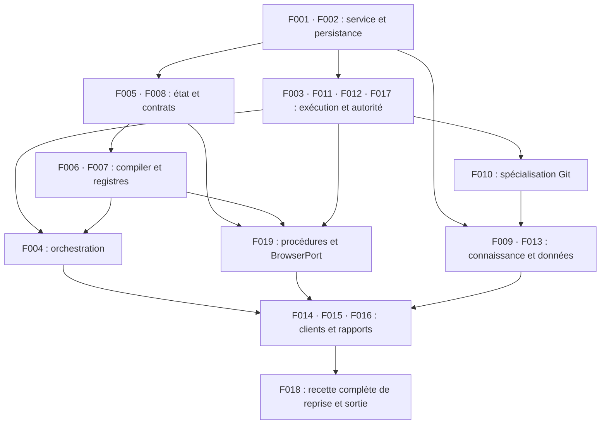

# Carte des dépendances d’implémentation

Les dépendances ci-dessous sont techniques, pas des étapes de qualité imposées aux workflows des utilisateurs. Elles couvrent les 19 features V1 : F001–F018 conservées et F019 intégrée au même cœur. Git est une spécialisation, pas un préalable à chaque projet ou replay.

Les flèches indiquent l'ordre d'intégration ; les dépendances réciproques de contrats sont levées par les frontières figées du tableau ci-dessous, conformément à [plans/dependencies.md](../plans/dependencies.md).

F018 n’attend pas la fin pour être développée : injection de panne et invariants commencent avec F002, puis couvrent progressivement tous les effets. De même, les politiques F017 précèdent le premier outil qui modifie un fichier.

La flèche Git → connaissance désigne l'indexation des repositories. Les fichiers/documents et la discovery d'automatisations restent possibles sans F010 activé pour le projet. F019 est un module du moteur, avec ports de données et de navigateur ; ni DB, ni file, ni orchestrateur additionnels. Le Model Router unique traite fournisseurs API et trois profils locaux, sans rendre un appel modèle obligatoire pour le replay.

| Frontière à figer avant parallélisme | Producteur | Consommateurs |
| --- | --- | --- |
| Identités, revisions, CommandEnvelope, Error, Event | F002 + architecture | Toutes |
| InvocationBundle, worker d'action et admission globale agent_invocation/replay_worker/provider_probe 5/50 | F003 + scheduler | F004 F005 F011 F012 F016 F019 |
| Workflow AST v1/v1.1/v1.2 (for_each borné), actions bornées, bindings, résultats, supervision et done | F005/F006 | F003 F004 F007 F008 F014 F015 F019 |
| Skill/RoleVersion et DiscoveryReceipt | F007/F009 | F003 F008 F014 F015 |
| ActionIntent, authorization, receipt, OutcomeUnknown | F017/F018 | Tous adaptateurs d’effet |
| SnapshotRef et capture_consistency | F009/F010 | Contrats, tests, contexte |
| ResourceRef/Revision/Assignment | F013 | F003 F009 F014 |
| Snapshot/cursor et pagination | F002/IPC | F014 F015 |
| AutomationArtifact/DataRevision, modèle interdit transitif et origine de conception distincte | F019/F005/F012 | F003 F007 F008 F014 F015 F016 F018 |
| BrowserPort, profils mediated/project_script, contexte/auth et effet inconnu | F019/F011/F017 | Moteur commun, clients et testkit |
| Qualification serveur/build/modèle/template/quantification/configuration, localité et OOM | F012/F017 | F003 F004 F005 F014 F015 F019 |
| Templates guidés, préparation idempotente des rôles/objets et aperçu d'effets | F004/F007/F019 | F014 F015, sans droits ajoutés par le client |

Les équipes utilisent des fixtures de contrat identiques. Un changement incompatible n’est pas résolu par des conversions divergentes dans chaque feature : le schéma canonique est versionné et une migration/test partagé est ajouté.

Les hypothèses H-17 à H-21 et INV-058 à INV-065 sont raccordées dans [les plans](../plans/v1-implementation-plan.md). Les dépendances externes navigateur/locales sont qualifiées tôt ; les tests de mocks et la validation des documents ne clôturent pas leur recette réelle. La supervision reste un graphe publié de tâches de décision entre blocs, sans ajout d'un juge LLM universel.

