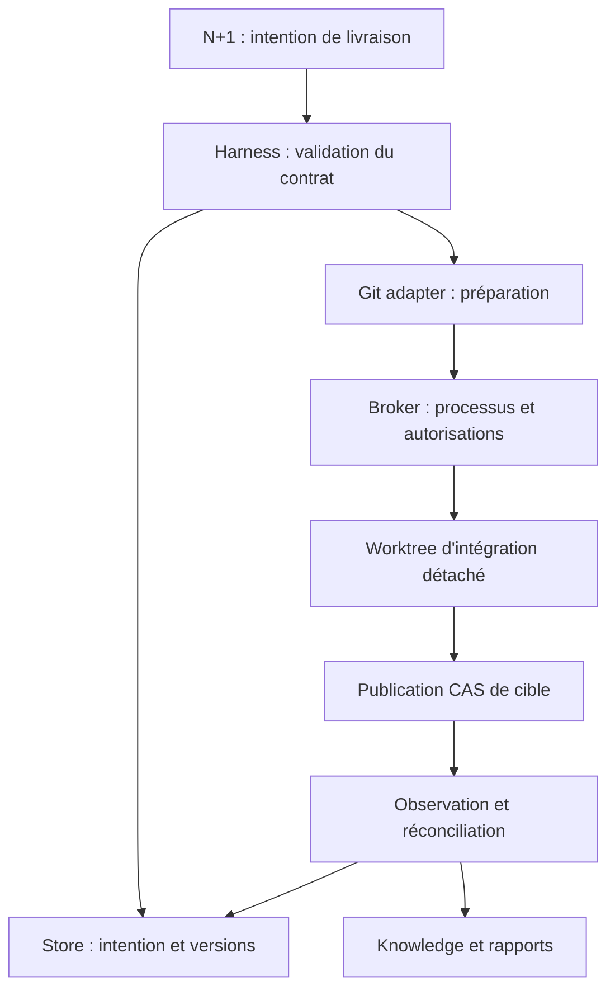

# Architecture — coordination Git et journal d'intégration

**Proposition V1, 16 novembre 2026.** Contrat canonique : [git-integration](../specs/git-integration.md). L'adaptateur Git est Rust et lance des commandes structurées via le broker ; Git système en ligne de commande est une dépendance externe inventoriée, de version minimale 2.39 décidée en R7 par [ADR-09](adr/ADR-09-git-worktrees.md) (accepté). Une version inférieure est refusée `CapabilityDenied/GIT_VERSION_UNSUPPORTED`. Aucune bibliothèque Git Rust n'effectue de mutation en V1 ; une alternative exigerait un ADR de supersession et une qualification fonctionnelle équivalente, sans changer les invariants métier.

## Frontières

Le daemon conserve l'état métier ; le Git adapter interprète les sorties documentées et les codes de résultat ; le broker possède identité, environnement, autorisation et suivi des processus. Un message LLM n'est jamais parsé comme commande shell à exécuter sans contrat. Les arguments sont passés séparément ; les formats NUL de Git évitent d'utiliser des lignes comme noms de fichiers.

## Machines d'état indépendantes

`WorktreeAllocation` évolue de `requested` à `active`, puis `quiescing`, `retired` ou `needs_reconciliation`. `IntegrationAttempt` suit `requested → preparing → prepared → publishing → published`, avec sorties `conflicted`, `stale`, `blocked_target_checkout`, `failed` et `outcome_unknown`. Une interruption en `publishing` ne devient pas automatiquement `failed` : l'effet peut avoir eu lieu.

`reconciliation_status` (= `GitActionState` de F010) est une enum fermée : `effect_observed` (résultat CAS reçu sous l'epoch courant), `desired_state_present` (cible = newOID, résultat absent), `candidate_included` (cible descendante de newOID), `target_diverged` (cible autre, non descendante), `observation_unavailable` (ref ou dépôt illisible) et `outcome_unknown`. Seul `effect_observed` fait passer automatiquement l'essai à `published`. Après une publication ouverte, les autres valeurs laissent l'essai en `outcome_unknown` jusqu'à `ReconcileAction`, puis jusqu'à une disposition `ResolveActionOutcome` enregistrée (F018), qui peut conclure `published` avec limite causale explicite, ou `stale` avec nouvel essai documenté.

Une lease de cible possède owner, scope, epoch, expiration et état `active/revoking/reconciling/released`. L'expiration déclenche la vérification des effets en cours, pas un nouveau propriétaire immédiat. Les ressources sont ordonnées pour l'acquisition : registre workspace, cible d'intégration, ressource auxiliaire spécifique. Aucun verrou de fichier général n'est maintenu pendant une attente de leader ou d'API.

## Journal minimal d'intégration

| Champ | Rôle |
|---|---|
| `action_id`, `attempt_id`, `command_id` | Corréler demande et essais ; `command_id` porte l'idempotence, scopée par acteur et lignée selon l'IPC v2, sans confondre redélivrance et retry |
| `repo_id`, `target_ref`, `source_oid`, `old_oid`, `new_oid` | Définir exactement l'effet prévu |
| `workflow_version`, `policy_version`, `scope_id` | Justifier la stratégie et les validations demandées |
| `owner_invocation`, `lease_epoch`, `broker_process_id` | Attribuer le droit et l'exécution |
| `intent_event_seq`, `dispatch_state`, `observed_result` | Distinguer intention écrite, processus parti et résultat reçu |
| `observation_refs`, `reconciliation_status` | Conserver l'incertitude et les observations de reprise |

L'intention et l'état d'essai sont atomiques dans SQLite. L'effet Git a lieu ensuite hors transaction. La primitive de comparaison sur OID empêche d'écraser une valeur différente de celle préparée ; elle ne prouve ni l'honnêteté d'un Git externe ni l'absence d'un passage intermédiaire ABA. Cette limite est affichée dans les diagnostics de reprise.

## Gestion des mutations et scopes

Le mode partagé d'un worktree exige un propriétaire de mutation et des patches sous préconditions de contenu. Les analyses en lecture peuvent être concurrentes avec badge de fraîcheur, mais une analyse demandant cohérence prend une capture de source. Un worker découvrant qu'il doit modifier un scope plus large demande une révision de contrat ; il ne contourne pas le scope par renommage ou symlink. Les liens symboliques et alias de chemins sont normalisés ou refusés selon politique avant accès effectif.

Les opérations Git modifiant les métadonnées communes — création de ref, config, nettoyage — sont médiées séparément des modifications de code. Un worktree par mission ne supprime pas ces interactions. L'inventaire initial et les événements périodiques de réconciliation détectent déplacements, suppressions et opérations externes, sans se fonder uniquement sur watchers.

## Intégration et fin de mission

La publication vérifie que la cible exacte du workflow est admissible. Une branche checkout dans un worktree quelconque, y compris en cours de rebase ou de bisect, n'est jamais mise à jour (Q-10, décision R7). En mode attaché, une cible checkout bloque la publication (`blocked_target_checkout`) et conserve le candidat ; l'UI propose par défaut une branche cible gérée non checkout pour les Runs créés ensuite (un Run engagé garde sa cible, Q-03 : seule la libération du checkout le débloque, sinon un Run successeur `predecessor_run_id`, créé après son état terminal, adopte la nouvelle cible), ou affiche les instructions exactes permettant à l'utilisateur de libérer lui-même le checkout, puis Unleash réobserve l'inventaire. Aucune avance rapide, aucun reset, stash ou checkout forcé n'a lieu dans le worktree humain, et le merge n'est jamais rendu silencieusement équivalent à un simple commit. Le contrat peut permettre une remise de candidat, mais c'est une définition de done différente et visible.

Un conflit crée un mandat d'intégrateur spécialisé avec ressources bornées. Les preuves requises sont recalculées sur son candidat. Le harness ne rajoute pas de tests à un workflow qui n'en contient pas ; il garde la différence entre résultat de merge et validation comportementale. Les événements de publication, rebase ou suppression invalident les index et reçus concernés et réveillent seulement les dépendants dont la condition est satisfaite.

## Contrôles de qualification

La qualification vérifie Git réel sur macOS et Linux, formats d'objet retenus, chemins atypiques, hooks, conflits, process survivant à un daemon, crash avant/après CAS et worktree cible humain. Une version du Git fournie par le système est sondée, avec 2.39 pour minimum qualifié ; une option non disponible doit produire une erreur de capacité ou un chemin qualifié, pas une sortie interprétée approximativement. Les tests et preuves attendues sont spécifiés dans [F010](../features/F010-git-coordination/tests.md).

## Identité brute des objets et références — R6

Le profil Git du harness désactive les replacement refs pour toute inspection, capture, préparation, validation, publication et réconciliation, avec `git --no-replace-objects ...` ou environnement équivalent contrôlé. [Git replace](https://git-scm.com/docs/git-replace), consulté le 16 novembre 2026, documente qu’un OID peut sinon être lu au travers d’une substitution. L’adaptateur épingle version Git et digest de profil effectif dans observations/preuves ; les sous-processus d’oracle reçoivent ce même environnement. La présence de refs/replace est signalée à l’adoption, sans les supprimer. Une preuve/index antérieur dont le profil est inconnu ne devient pas compatible par simple égalité d’OID : il est marqué à réconcilier.

Les cibles de publication et refs de conservation gérées doivent être **directes**, appartenir au namespace autorisé et être qualifiées au moment de la préparation. TargetRef contient nom complet, kind=direct, précondition attendue (OID exact ou `ref_absent`) et profil de lecture. Une symref préexistante est refusée `CapabilityDenied/SYMBOLIC_TARGET_UNSUPPORTED`. Les créations, CAS et suppressions sont qualifiés sans déréférencement, notamment `update-ref --no-deref` : le [manuel Git](https://git-scm.com/docs/git-update-ref), consulté le 16 novembre 2026, distingue ce comportement du déréférencement par défaut.

Le contrôle de cible checkout reste distinct. L’option no-deref évite de déplacer le référent d’une symref ; elle ne crée pas une transaction atomique avec l’inventaire des checkouts ou les mutations d’un Git extérieur. Le profil doit qualifier le comportement CAS en cas de substitution concurrente, observer la ref après publication et classer toute divergence `outcome_unknown`/quarantaine. Aucune option non supportée ne peut être ignorée. Un Git extérieur hostile reste hors garantie d’exclusion ; les opérations conformes du harness restent sérialisées par lease et writer.

Alternative : supporter les symrefs et replacements en épinglant chaîne de résolution, mapping, ACL et profil dans chaque snapshot/preuve. Ce coût n’est pas justifié pour le profil V1 retenu par ADR-09. Le refus ciblé conserve les autres fonctions Git et ne réécrit pas un dépôt utilisateur.
