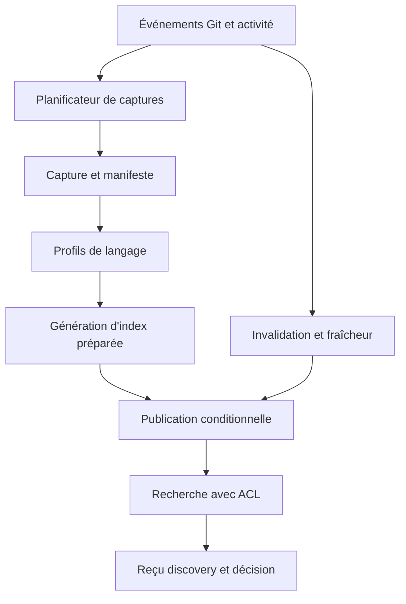

# Architecture — captures et index de connaissance

**Architecture V1, 16 novembre 2026 ; [ADR-08](adr/ADR-08-knowledge-index.md) accepté en R7.** Référence normative produit : [shared-knowledge](../specs/shared-knowledge.md). Les trois plans de connaissance sont stockés logiquement séparés même si SQLite héberge plusieurs tables. `.claude/` contient la conception ; les index, archives et bases sont dans les répertoires runtime de données configurés, jamais dans ce dossier documentaire.

## Pipeline borné

Le planificateur coalesce les événements rapprochés par source sans perdre les frontières commit/rebase/delete, changement de document/fichier, révocation et publication de registre. Il attribue une génération durable et un budget CPU/mémoire/processus. Les profils LSP sont des auxiliaires, distincts des slots d'exécution du pool commun. Une file pleine ralentit l'indexation et rend le retard visible ; elle ne multiplie pas des serveurs sans limite. Git est un adaptateur de source ; son absence ne suspend pas les sources fichiers, documents et registres.

## Capture et analyse

La voie commit énumère un tree déterminé avec les primitives Git et lit ses blobs. La voie dirty matérialise les octets capturés dans un espace propre, versionne le manifeste et annonce `unverified` ou `inconsistent` sauf mécanisme atomique réellement qualifié. Un snapshot matérialisé n'est pas analysé via le worktree vivant après capture. Les bases de compilation, fichiers de configuration et manifests de dépendances utilisés sont archivés avec leurs digests.

Le `TypedSourceRef` commun conserve quatre variantes fermées : `git_snapshot`, `resource_snapshot`, `file_snapshot` et `registry_version`. La voie documentaire réutilise `ResourceSnapshot` de F013 et son extraction versionnée ; la voie fichiers utilise un `SourceBinding`/une racine autorisée, un manifeste et une génération locale sans faux repository. Une version immuable de registre est référencée par identité/namespace/version. Les archives conservent cohérence, digest, politique/ACL et dates ; seule la variante Git contient repo/worktree/OID. La conversion vers le DTO commun est contrôlée par [le contrat de source](../specs/shared-knowledge.md) et [son schéma](../schemas/discovery-receipt.schema.json), pas par la présence d'une chaîne nommée snapshot_id.

Chaque profil de langage reçoit un répertoire de capture, ses capacités et une configuration explicite. Un serveur ne peut pas charger librement toutes les configurations, plugins ou exécutables suggérés par un dépôt non approuvé. Les flags de build, scripts, proc-macros, annotation processors, téléchargements de modules et acquisition de types sont des effets contrôlés. Par défaut, un dépôt non marqué « de confiance » a ses build scripts, proc-macros et plugins exécutant du code du projet désactivés, et le réseau des analyseurs est refusé ; la limite est affichée sur les résultats ([Q-13](../specs/shared-knowledge.md#couverture-des-langages-v1)). Le mode de lecture dégradé continue avec portée réduite et signale les imports ou résolutions absents.

L'adaptateur LSP associe chaque requête à `snapshot_id`, `profile_version`, `request_id` et versions des documents. Les résultats arrivant après invalidation sont ignorés ou conservés comme historiques, jamais publiés dans la génération actuelle. Les positions sont converties selon l'encodage négocié, avec fixtures Unicode ; une colonne UTF-16 ne devient pas un offset d'octets par simple cast. Le protocole [LSP 3.17](https://microsoft.github.io/language-server-protocol/specifications/lsp/3.17/specification/), consulté le 16 novembre 2026, décrit synchronisation et gestion des réponses périmées.

## Modèle de données

| Ensemble | Clé et contenu | Autorité | Base |
|---|---|---|---|
| `source_snapshots` | Type, source/version, manifestes ou référence ResourceSnapshot/version de registre, cohérence, ACL, rétention | Archive d'observation durable ; références discriminées et résolues | Autorité |
| `index_generations` | Source, état, profil, erreurs, watermark événement, pointeur de génération active | Projection remplaçable | Autorité |
| `symbols` | Snapshot + identifiant local, kind, signature, spans et confiance | Projection de code | Dérivée par génération |
| `relations` | Source/cible, nature, confiance, provenance | Projection de code ou déclaration qualifiée | Dérivée par génération |
| `work_intentions` | Mission, scope, artefacts visés, échéance et auteur | Activité observée/déclarée | Autorité |
| `dependency_edges` | Mission source/cible, condition, état, délai | Domaine durable | Autorité |
| `discovery_receipts` | Intention/révision, origine typée, sources/couverture, décision, base de validation et fraîcheur observée | Preuve procédurale immuable | Autorité |
| `discovery_query_records` | Requête normalisée, sources/catalogues consultés même vides, contexte d'analyse, résultats filtrés, limites et curseurs | Observation durable servant au reçu ; pas un cache de recherche | Autorité |
| `discovery_uses` | Autorisation avant effet, opération/payload/cible, sources, révisions et borne ; observation après effet | Liens durables append-only ; une opération logique par reçu préalable | Autorité |
| `discovery_eligibility` | Fraîcheur courante, état d'usage et invalidations causales | Projection reconstruisible ; ne réécrit pas l'historique | Autorité |
| `search_projection` | Champs textuels, index lexical SQLite FTS5 (tokenizer `trigram` pour le code, `unicode61` pour la prose) et filtres de visibilité | Reconstructible | Dérivée par génération |

« Autorité » désigne la base [ADR-01](adr/ADR-01-sqlite-persistence.md), écrite par le writer commun. « Dérivée par génération » désigne une base SQLite propre à chaque génération d'index, sous le sous-répertoire `index/` de la racine de données ([ADR-08](adr/ADR-08-knowledge-index.md)). Le filtrage ACL précède classement, compteurs et extraits.

L'identité d'un symbole est propre à une analyse ; un renommage ou déplacement peut créer un nouvel identifiant. Un lien de continuité peut être inféré avec confiance et provenance, sans promettre une identité sémantique parfaite à travers refactorings. Les résultats interlangages relient explicitement API et contrats plutôt que d'inventer des arêtes d'appel.

## Publication, rebuild et requêtes

Une génération est construite hors base autoritaire dans des lots bornés : copie de la génération précédente plus le delta du snapshot, ou reconstruction complète, puis la base dérivée devient immuable. La publication compare source, génération attendue, watermark et révision d'ACL ; un résultat ancien devient historique ou est abandonné. Le pointeur actif change dans une transaction courte de la base d'autorité. On conserve la génération active et la précédente ; les autres sont collectées. Un rebuild repart des snapshots encore disponibles et du journal ; une source supprimée par rétention reste indisponible, pas reconstituée par imagination.

La clé de comparaison inclut type de source, `source_id`, `version_id`, génération, contexte d'analyse et ACL ; la même valeur numérique de génération dans deux worktrees ou deux documents n'est pas une identité commune. Après crash, chaque adaptateur rapproche versions, digests, autorisations et curseurs de son scope. Une source locale ou documentaire peut retrouver `current` sans Git. Le profil ne reçoit jamais de champs Git fabriqués pour compléter le DTO.

La recherche filtre les ACL avant classement et agrégation, puis combine correspondance exacte, tokens, symboles, signatures et intentions. La réponse cite ses sources et indique `complete`, `partial`, `stale` ou `unavailable`. Les budgets de résultats, de fichiers et d'octets évitent qu'une recherche alimentant un modèle dépasse son contexte. Les résumés sont accompagnés des extraits et du manifeste réellement transmis.

Les annotations datées sont calculées pour le `consumer_context_ref` contrôlé. Hors Git, code/intégration sont `not_applicable` ; source, travail, disponibilité et fraîcheur restent représentés. Les caches incluent principal, scope/révision, contexte consommateur, ACL, sources et versions ; une copie historique autorisée n'implique pas autorisation de nouveau contexte après révocation.

## Admission d'un reçu et clôture

Le `DiscoveryService` obtient l'origine du broker : invocation/tentative, replay/run/step/worker, ou control_plane/principal, avec cause vérifiable. Il ne résout pas l'autorité depuis le payload du demandeur. La validation structurelle du schéma interdit les mélanges ; le writer vérifie les FKs, appartenances et égalités de principal selon les contraintes des actions.

Le contrôle avant effet prépare les relectures/recaptures hors transaction. La transaction courte compare intention, scope, catalogue, versions de sources/cible, ACL, politique/validateur et curseur observé ; elle lie le reçu à l'opération et au digest réel du payload, réserve l'identité create et persiste la borne. La transition dispatching vérifie de nouveau ces révisions observées, l'éligibilité, la borne et les fences ; une invalidation survenue après autorisation bloque le dispatch. Une nouvelle modification exige comparaison/revalidation, sans promettre de snapshot atomique d'un répertoire externe. L'observation après effet conserve la cible/version effectivement créée ou réutilisée et les séquences ; une issue inconnue n'est pas une consommation réussie.

La clôture utilise l'[algorithme normatif](../specs/shared-knowledge.md) : preuve historique préalable, réconciliation actuelle bornée, puis classification des changements entre l'usage et le curseur de clôture. L'effet propre exclu est la mutation exacte liée, éventuellement sa publication à contenu/configuration identiques prouvée. Une autre action du même auteur reste extérieure à cet usage. Un changement extérieur pertinent requiert `completion_revalidation`, sources et cible finales exactes, politique/validateur épinglés, nouveau curseur et `valid_until` ; la clôture compare encore ces préconditions dans sa transaction. Les événements manquants imposent réconciliation ou `unknown`, jamais une inférence « rien n'a changé ».

Un changement n'efface ni reçu ni usage historique. Une nouvelle recherche à la clôture conserve `observed_after_creation` et ne devient pas une preuve d'antériorité. Les observations de validation renouvelant seulement une borne sont distinctes d'une nouvelle discovery et prouvent l'égalité des références contrôlées ; leurs dates, versions et résultats sont conservés. Le writer/outbox et les contrats communs restent l'unique moteur d'autorité.

## Frontières Rust

`unleash-knowledge` possède capture, planification, index, requêtes et domaine discovery. Un module/adaptateur par langage encapsule LSP 3.17 (`lsp-types`, client JSON-RPC Rust sur stdio) et ses options ; il n'expose pas des objets internes du serveur au domaine. `unleash-store` écrit les métadonnées, événements et preuves ; `unleash-action-broker` contrôle les processus et fichiers ; les contrôles de preuve appartiennent au moteur de contrats d'`unleash-harness` ([espace de travail Rust](rust-workspace.md)). Les appels lents ne traversent jamais une transaction d'état tenue ouverte.

La bibliothèque tree-sitter et ses grammaires officielles (Rust, Go, Java, Python, TypeScript/TSX) sont adoptées comme dépendance native explicitement inventoriée (R7), versions et licences figées ; aucun autre parseur C n'est embarqué implicitement. Les analyseurs externes multilangages sont détectés et inventoriés comme tels, avec runtime et licence à qualifier ; Unleash ne les télécharge jamais implicitement. La mémoire, le temps et les erreurs de chaque profil restent observables. Les critères de qualification sont dans [les tests F009](../features/F009-knowledge-engine/tests.md), tous attendus et non exécutés à ce stade.
