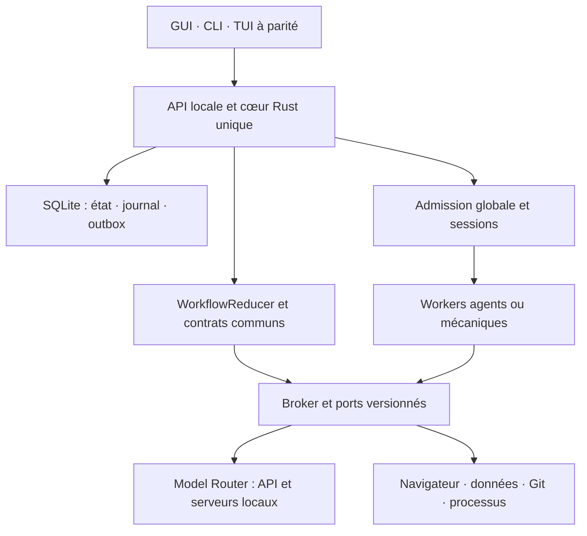

# Architecture consolidée proposée — OVPT Unleash

Cette architecture est consolidée après R3–R6 ; ses choix structurants sont arrêtés par les ADR acceptés en [R7](../brief/revision-2026-11-16-r7.md). Elle n'est ni une implémentation ni une décision utilisateur implicite sur chaque mécanisme. Les invariants confirmés sont dans [brief](../brief/invariants.md). La V1 conserve F001–F018 et ajoute F019, soit 19 features. Le [registre des questions](../brief/open-questions.md) conserve les IDs : Q-01 et Q-17 sont résolues par la clarification R2, toutes les autres sont tranchées en R7.

## Forme générale

Un daemon utilisateur Rust possède l’état opérationnel et les services communs. Une GUI à hôte Rust, une CLI et une TUI Rust sont des clients du même catalogue d’opérations. La GUI est un shell Tauri 2 avec renderer React/TypeScript ([ADR-03](adr/ADR-03-rust-gui.md)) ; Ratatui/Crossterm est la pile terminal retenue ([ADR-15](adr/ADR-15-interface-parity-and-pragmatic-rust.md)). Les trois clients accèdent au daemon par le seul client partagé `unleash-client`. Les agents sont des identités durables invoquées sur événements ; leurs workers sont éphémères. Des workers de replay réalisent aussi des procédures publiées sans agent. Process-hosts, moteurs navigateur et serveurs d'inférence externes réutilisés sont des ressources qualifiées ; ils ne deviennent pas des managers ou une deuxième autorité métier.

Aucune flèche ne donne au modèle ou au renderer GUI la propriété de la base. Le renderer React/TypeScript passe par l'hôte Tauri Rust restreint, puis par l’IPC du daemon ; la TUI utilise directement le même client IPC. La fermeture de l’hôte GUI ne ferme pas le daemon. Un résultat LLM devient proposition typée. Le noyau vérifie autorité, révision, contrat, budget et transition, puis engage état et intent. L’exécution externe suit après commit. Son résultat revient comme observation avec provenance.

## Responsabilités et sources de vérité

N+2 organise et arbitre ; N+1 choisit la réalisation technique dans son mandat ; N réalise. Le noyau ne prétend pas juger la pertinence universelle du code. Il peut vérifier un test exécuté sur un snapshot, pas conclure que sa couverture est suffisante sans critère demandé.

Git et les fichiers observés définissent le code lorsqu'un repository est utilisé ; SQLite définit états et activités enregistrées ; snapshots et artefacts identifient les preuves ; les index de recherche sont dérivés. Un projet peut contenir des données, documents ou procédures sans aucun dépôt Git. Un CSV devient une `AutomationDataRevision` immuable ; un `AutomationArtifact` publié référence sa procédure et ses contrats, et non la mémoire d'une session d'apprentissage. Un helper trouvé dans une branche n’est jamais présenté comme disponible dans un autre worktree sans preuve de présence.

## Chemin nominal

Goal et mission peuvent utiliser un workflow de développement, un template guidé ou un artefact d'automatisation. La création sélectionne une source typée du même `Run` ; `AutomationRun` en est une projection, pas un autre orchestrateur.

| Parcours | Exécution et clôture |
|---|---|
| Travail agent | Tâches N et décisions N+1/N+2 explicitement nécessaires, actions broker, observations et done du workflow. Aucune revue supplémentaire universelle. |
| `replay` | Actions mécaniques des profils v1.1 ou v1.2 (v1.2 requis pour for_each borné) sous `model_policy=forbidden`, nouvelles données épinglées, pré/postconditions et rapport déterministes ; aucun agent, clé modèle ou Git requis par principe. |
| `supervised` | Même moteur et blocs mécaniques, avec `task leader_decision`/`choice` publiés aux checkpoints ou exceptions anticipées. Logs, assertions et snapshots alimentent des décisions bornées, sans LLM par clic. |

Les managers restent dormants lorsque le done est mécanique. L'attente des descendants ou d'une décision est durable et ne conserve pas une unité inutile. Une réparation est un travail de conception séparé, autorisé à la demande ou par politique préautorisée ; sa nouvelle publication ne modifie ni les données ni la version d'un run engagé. Les inconnues d'effet survivent aux changements de run ou de version.

Une nouvelle compétence peut être demandée au N+2, rédigée par un spécialiste puis publiée. Le N+1 crée des rôles persistants et lie une version à un slot encore non engagé autorisé par son workflow. Les bindings engagés ne changent pas ; une mise à jour n’est jamais un alias latest suivi automatiquement.

## Interfaces guidées, moteurs et capacité

Le parcours guidé permet de décrire un résultat, sélectionner des données et utiliser une procédure proposée sans configurer d'abord des agents ou un graphe. Le backend prépare les objets et rôles nécessaires dans le mandat existant, avec commandes idempotentes et aperçu des effets ; les modes guidé/expert n'accordent pas des permissions différentes. Comptable, particulier et développeur accèdent aux mêmes fonctions depuis GUI et TUI, y compris détails, configuration locale, réparation et preuves. Voir [périmètre polyvalent](../brief/general-purpose-scope.md) et [parcours guidé](../design/guided-automation-experience.md).

Le module d'automatisation appartient au moteur Rust commun. `BrowserPort` utilise un adaptateur WebDriver Rust (`fantoccini`) sur Chrome for Testing et chromedriver épinglés (Q-18) ; Playwright sert aux scripts de projet `project_script`, et les scripts utilisateur dans d'autres langages sont des artefacts externes avec garanties déclarées, sans backend métier parallèle. Le profil médié reste la référence lorsque les autorisations d'effets doivent être vérifiées action par action. Une allowlist de domaine ne prouve pas l'interdiction d'achat sur ce même domaine.

LM Studio, Ollama et llama.cpp sont des profils du Model Router existant, qualifiés par tuple serveur/build, modèle/révision, template, quantification et configuration. Ni la marque ni `localhost` n'établissent le placement de l'inférence. `local_only` exige une cible vérifiée sur la machine du daemon et interdit un fallback cloud silencieux, notamment après OOM. `forbidden` interdit aussi modèle local, warmup, embeddings et réveils cachés. Les [contrats locaux](../specs/local-models.md) séparent capacités, placement, transport et limites de ressources.

Le [scheduler](../specs/scheduling.md) partage 5 unités actives par défaut, 50 au maximum, entre invocations agentes, workers mécaniques et probes fournisseur. Les permis d'action, contextes navigateur, processus et générations locales sont des sous-limites ou ressources supplémentaires, jamais des pools contournant ce plafond. Les délais de préemption sont bornés seulement sous les hypothèses de checkpoint et d'annulation réellement qualifiées.

Ces ajouts raccordent INV-058 à INV-065 et les hypothèses H-17 à H-21 ; ils ne réduisent aucune des capacités antérieures de développement, collaboration, Git, connecteurs ou parité terminal.

## Reprise et échecs

Les queues, budgets, contrats et sessions survivent au worker. Un daemon redémarré reconstruit l’état engagé, change d’epoch, réconcilie les processus et les effets, puis reprend ce qui est prouvé récupérable. Il ne rejoue pas automatiquement un merge ou une requête distante dont l’issue est inconnue.

Les processus longs peuvent garder un process-host Rust pour conserver PTY et spool. Ce composant ne fait pas d’appels LLM et n’a pas autorité pour réaffecter une mission. Après reboot machine, son état OS est perdu ; le système revient aux références durables et aux règles de relance.

## Complexité retenue et écartée

Retenus : un writer SQLite, outbox/inbox, commande idempotente, revisions, leases avec fencing, snapshots, context manifests, ports d’effet et capacité explicite. Écartés par défaut : Redis, bus distribué, microservices pour chaque domaine, event sourcing intégral, plugin de guard arbitraire, contrôle des transitions par prose.

Ce choix ne réduit pas la V1. Il rassemble les fonctions dans un cœur local cohérent tout en laissant les équipes travailler sur des contrats de modules indépendants. Les [ADR](adr/README.md) comparent alternatives et coûts ; le [plan](../plans/v1-implementation-plan.md) distingue ordre de construction et sortie complète.

